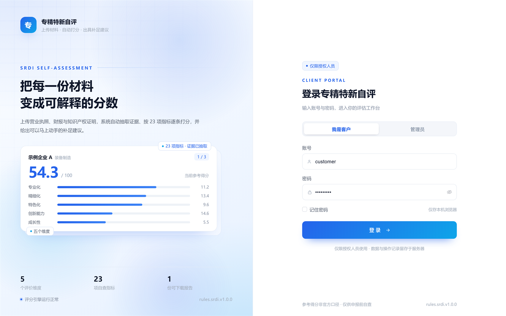
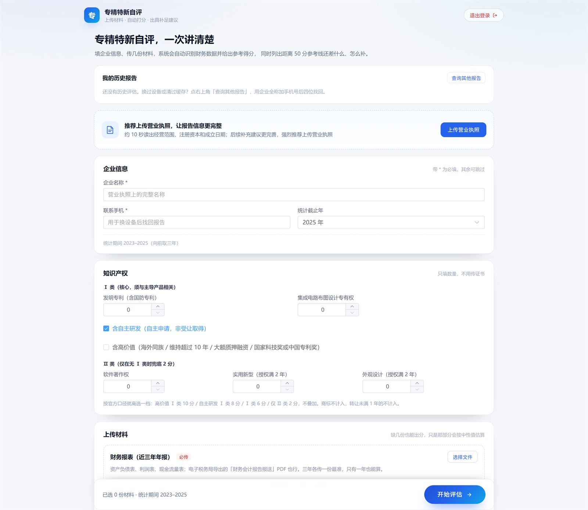
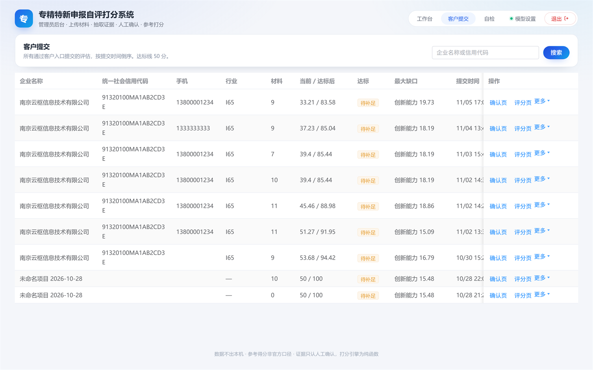
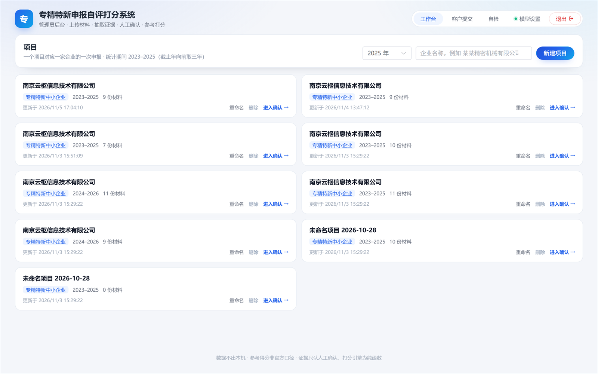
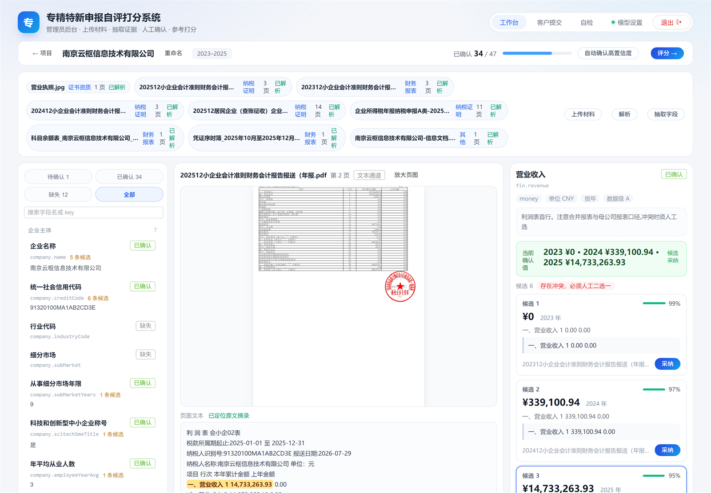
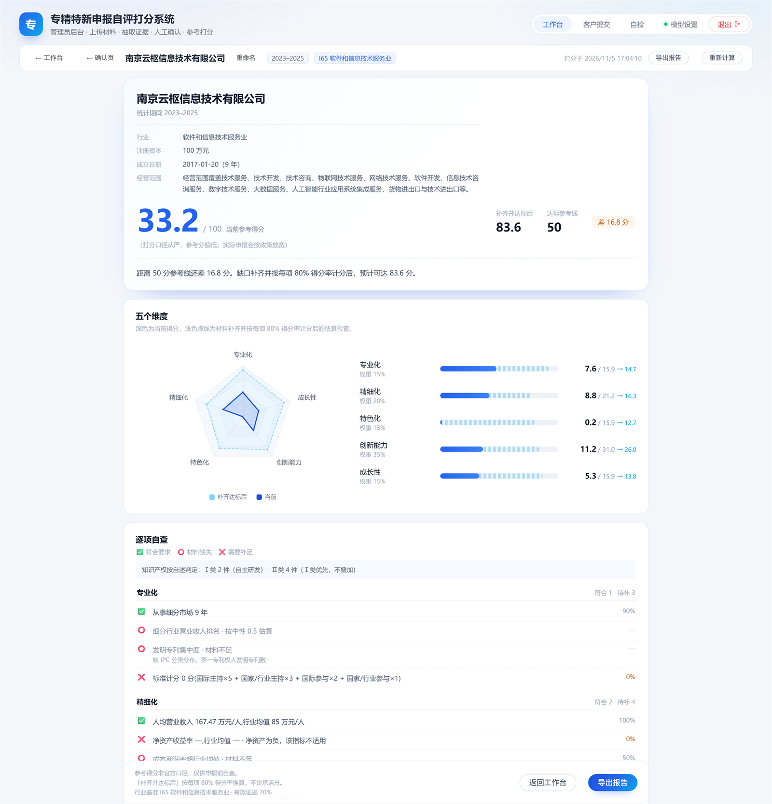

# 专精特新申报自评打分系统

[](LICENSE)
[](https://github.com/Canscx/srdi/releases)
[](package.json)
[](web/package.json)
[](tsconfig.base.json)
[](package.json)
[](CHANGELOG.md)

上传企业申报材料 → 自动抽取证据 → 人工确认 → 规则引擎打分 → 输出差距诊断与补足建议。

面向「优质中小企业梯度培育 · 专精特新中小企业」申报场景：把散落在审计报告、纳税申报表、专利清单里的数据变成可解释、可追溯、可复现的分数，并告诉企业距离达标线还差什么、怎么补。



## 这是什么

| 能力 | 说明 |
| --- | --- |
| 材料解析 | 图片 / PDF / DOCX / XLSX 双通道解析：文字型抽文本层，扫描件转图交视觉模型识别 |
| 证据抽取 | 47 个字段逐项抽取，每条标注来源文件、页码与原文引用，值有歧义时保留多个候选 |
| 人工确认 | 唯一写分数的入口；冲突候选强制二选一，缺证据如实标「材料不足」 |
| 规则打分 | 6 项门槛 + 23 项指标（5 个维度），纯函数引擎计算，输出三口径区间 |
| 双轨报告 | 客户版 4 页 A4 PDF（分数 + 雷达 + 清单 + 建议），内部版 Markdown / PDF 完整报告 |
| 双角色 | 管理员后台（完整流程）+ 客户轻流程（5 屏一键评估），接口层按角色分区 |

## 核心设计

> **AI 只抽取证据、只写建议。分数由纯函数规则引擎计算。**

理由是三条硬要求：**可复现、可追溯、可校准**。让模型直接给分，这三条一条都做不到。

由此派生出五层解耦，跨层只认两份带 JSON Schema 的契约（`evidence.json` / `score-result.json`）：

```
L1 解析  文件 → PageDoc[]          纯 Node，不认识任何业务字段名
L2 抽取  PageDoc[] → Candidate[]   只 append 候选，绝不写 value
L3 确认  Candidate[] → Confirmed   唯一写 value 的地方，唯一人工闸门
L4 打分  evidence + rules → ScoreResult   纯函数，零 I/O，零 AI，可单测
L5 报告  ScoreResult → 报告        模板渲染；AI 只润色，不产数字
```

硬约束写进代码评审清单：L1 不知道字段名、L2 不写 `value`、L3 是唯一写入口、L4 无 I/O、L5 不产分数。

## 界面

**客户入口**：填企业信息、传材料、一键评估，5 屏走完。



**管理员后台**：客户提交总览，按提交时间倒序，可直接进确认页或评分页。



**项目管理**：一个项目对应一家企业的一次申报，材料、证据与得分都落在本地目录。



**确认页**：左侧字段清单、中间页图与原文摘录高亮、右侧候选卡片。冲突候选必须人工二选一——这是唯一写分数的入口。



**评分结果页**：客户结果页与管理员评分页共用同一个组件、同一份数据源，只是管理员多一层可折叠的专业视图。



## 快速开始

环境：Node ≥ 20.11、pnpm ≥ 9。

```bash
pnpm install
pnpm start        # 构建前端并启动服务，http://localhost:8787
pnpm dev          # 开发模式：服务 8787 + 前端 5180
```

默认账号见 `.env.example`：`admin`（后台）与 `customer`（客户入口）。**开放访问前务必改掉默认密码**，尤其 `customer`——它会被发给客户。

### 配置模型

抽取字段需要模型接口。启动服务后点右上角「模型设置」，填 API 地址与 Key 保存，立即生效，不用重启。也可以用环境变量兜底（页面配置优先）：

```bash
# .env
AI_BASE_URL=https://api.deepseek.com/v1
AI_MODEL=deepseek-flash
AI_API_KEY=sk-...
```

未配置 Key 时上传与解析仍可用，抽取作业会明确报「尚未配置模型 API Key」，不会静默失败。

### 跑通全流程

没有真实材料时，用 `samples/` 里两套虚构企业材料（各 5 份、共 8 页）跑通上传 → 解析 → 抽取 → 确认 → 评分 → 导出，见 [samples/README.md](samples/README.md)。样本与 golden 快照同源，可由 `pnpm samples` 重新生成。

### 中文字体

导出 PDF 需要一个中文字体。查找顺序：`REPORT_FONT_PATH` → 项目根 `fonts/` 目录 → 系统字体（Windows 黑体 / macOS 苹方 / Linux Noto CJK、文泉驿）→ `fc-match`。字体集合（.ttc）会按字体内部的 PostScript 名解析，不用手工填 family。一条命令自检：

```bash
pnpm check:font   # 打印候选与选中项，并真的生成一张 PDF 验证中文可写可提取
```

## 评分口径

| 项 | 值 |
| --- | --- |
| 规则包 | `rules.srdi.v1.0.0`，生效日 2026-04-01 |
| 门槛 | 6 项（资格与合规），逐条判定「满足 / 不满足 / 材料不足 / 需人工确认」 |
| 指标 | 23 项，5 个维度：专业化 15 / 精细化 20 / 特色化 15 / 创新能力 35 / 成长性 15 |
| 达标线 | 参考得分 ≥ 50 分 |
| 三口径 | 保守 / 参考 / 乐观，缺证据越多区间越宽 |
| 字段目录 | 47 个字段（含 3 个 `identity.*` 展示字段） |
| 行业基准 | 14 个行业 |

**三级指标权重官方未公布**，本工具按维度内等权处理，参考得分仅供自查，不得对外称官方口径。8 项指标依赖行业均值、2 项完全不可得，因此产品定位是「门槛预检 + 差距诊断 + 补强路线图」，不是「官方同款分数」。

## 目录结构

```
config/     规则包、字段目录、行业基准、prompt 与客户流程参数
shared/     零依赖纯函数：打分引擎、7 种打分器、JSON Schema、前后端共享类型
server/     Express 5：解析 / 抽取 / 确认 / 打分 / 报告 / 门户 / 鉴权
web/        Vue3 + Element Plus：登录、客户轻流程、管理员后台、确认页、评分页
samples/    两套虚构企业材料（可直接导入）
docs/       架构、打分数学、解析契约、客户流程方案、故障复盘
deploy/     宝塔部署手册 + nginx / PM2 配置 + 更新 / 备份 / 回滚脚本
scripts/    配置校验、便携包构建、浏览器冒烟
```

`data/`、`fonts/`、`.env` 永不入库。

## 技术栈

| 层 | 选型 |
| --- | --- |
| 前端 | Vue 3 + TypeScript + Vite + Element Plus + ECharts |
| 后端 | Node 22 + Express 5（单进程，托管前端静态产物） |
| 存储 | 纯文件系统：项目级 JSON + 原子写 + 串行锁，无需数据库 |
| 解析 | pdfjs-dist + @napi-rs/canvas、mammoth、xlsx |
| 报告 | pdfkit（矢量雷达 + 中文字体嵌入） |
| 工程 | pnpm workspaces（shared / server / web）、Vitest、tsx |

选型取舍见 [docs/architecture.md](docs/architecture.md) 与 `PROGRESS.md` 的「决策记录」。

## 开发

```bash
pnpm validate     # 提交前必跑：配置校验 + 三包类型检查 + 全部测试
pnpm test         # 仅测试：shared 147 条 + server 154 条
pnpm typecheck    # 仅类型检查
pnpm samples      # 由 fixtures 反向生成样本材料
pnpm pack:portable  # 构建免安装便携包
```

测试覆盖判型 / 存储 / 上传 / 四格式解析 / AI 抽取契约 / 确认 / 打分 / 报告 / 门户 / 鉴权 / 字体，共 23 个 server spec 与 12 个 shared spec。

## 部署

三种形态，按场景选：

| 场景 | 方式 | 入口 |
| --- | --- | --- |
| 自己用 | `pnpm start`，浏览器开 `localhost:8787` | — |
| 给不装环境的同事 | 免安装便携包，解压双击 `启动.bat`，内置 Node | `pnpm pack:portable` |
| 小团队共享（绑域名） | 宝塔面板 + Node 项目 + nginx 反代 + 登录页 | [deploy/README.md](deploy/README.md) |

服务器更新走 `deploy/update.sh`：更新前自动把当前代码打成快照，出问题用 `deploy/rollback.sh` 一键退回，不会丢 `data/`、`.env`、`fonts/`。

部署版是**单账号共享**：默认 `admin`，密码走环境变量 `AUTH_PASSWORD`，全员共用，数据不按人隔离。要按人隔离得改架构，不是在面板上勾选项能解决的。

## 政策依据

- 《优质中小企业梯度培育管理办法》工信部企业〔2026〕2 号，2026-04-01 施行
- 《中小企业专精特新发展评价指标体系（企业）（试行）》工信厅企业〔2024〕75 号
- 达标口径：专精特新中小企业评价得分 ≥ 50 分（复核企业近两年任一）

## 文档索引

| 文档 | 内容 |
| --- | --- |
| [docs/architecture.md](docs/architecture.md) | 五层架构、接口契约、状态机、路线图与风险 |
| [docs/scoring.md](docs/scoring.md) | 打分数学、七种打分器、B 类曲线、三口径、手算样例 |
| [docs/pipeline.md](docs/pipeline.md) | 解析链路、扫描件识别、AI 契约、校验阶梯 |
| [docs/PLAN-customer-portal.md](docs/PLAN-customer-portal.md) | 客户轻流程方案与取舍 |
| [docs/HANDOVER-font-bug.md](docs/HANDOVER-font-bug.md) | PDF 字体故障复盘 |
| [deploy/README.md](deploy/README.md) | 宝塔部署：服务器要求、安装顺序、更新与回滚、排错对照表 |
| [CHANGELOG.md](CHANGELOG.md) | 版本变更记录 |

**配置即文档**，不再单写 markdown：

- 47 个字段的类型、单位、别名、指标映射 → `config/catalog/field-catalog.v1.json`
- 六项门槛与 23 项指标的全部参数 → `config/rules/rules.srdi.v1.0.0.json`
- 8 项 B 类指标的行业基准 → `config/benchmarks/industry-benchmarks.v1.2.0.json`

改配置就改行为，不会出现「文档说 A、代码做 B」的漂移。

## 免责声明

本工具输出为**自查参考**，非官方评分。三级指标权重官方未公布，参考得分为估算值，不可用于申报材料中的自评分数填报。最终认定以省级中小企业主管部门审核结果为准。

## License

[Apache-2.0](LICENSE) © 2026 Canscx
